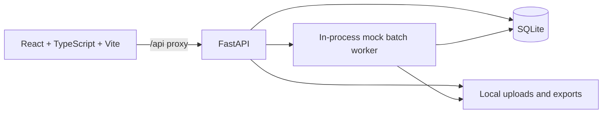

# CommerceScene

CommerceScene is a product-content workspace for e-commerce teams. It brings a product catalogue, reusable visual guidelines, scene configuration, image review, and export preparation together in one application.

The current repository provides a **runnable local development application**. Its mock generation provider creates clearly labeled preview artwork so you can exercise the catalogue-to-export workflow without external AI credentials or paid requests. This is a development build and is **not yet the production-ready application specified in [`spec.md`](spec.md)**.

## Contents

- [What works today](#what-works-today)
- [How the application is structured](#how-the-application-is-structured)
- [Requirements](#requirements)
- [Run locally](#run-locally)
- [Use the application](#use-the-application)
- [Configuration and stored data](#configuration-and-stored-data)
- [API overview](#api-overview)
- [Build and verification](#build-and-verification)
- [Security and production readiness](#security-and-production-readiness)
- [Project files](#project-files)
- [Roadmap and known limitations](#roadmap-and-known-limitations)

## What works today

- **Dashboard:** real counts and recently changed products from the local database.
- **Catalogue:** browse and search products, add products, edit product details, open product pages, and import CSV rows.
- **Source photography:** upload JPEG, PNG, or WebP references. The API checks the declared MIME type, file signature, decoded image, file size (20 MB maximum), and dimensions before registering a local file.
- **Brand studio:** create and edit reusable brand profiles with palette, lighting, framing, background, and tone settings. Edits increment the profile version.
- **Scene studio:** select products, a scene preset, brand profile, and variation count.
- **Mock generation:** submit a batch and see persisted batch status and generated outputs. Each output is marked as a mock preview and is not represented as real AI generation.
- **Asset review:** browse generated assets, filter by review or approval state, and approve assets for export.
- **Exports:** create a ZIP from approved assets. The package includes organized product/marketplace folders and a `manifest.csv`.
- **API documentation:** FastAPI OpenAPI docs are available at `/docs` while the API is running.

## How the application is structured



- `apps/web` is the React, TypeScript, and Vite frontend. React Router handles pages; Lucide provides icons; the interface uses a responsive local component and CSS system.
- `apps/api/app/main.py` contains the FastAPI API and local application behavior.
- SQLite stores products, registered images, brand profiles, generation batches, generated assets, and exports.
- Uploaded images, mock output images, and ZIP archives are stored locally under `commerce-data/` by default.
- The mock worker runs in a thread in the API process. Its job state is written to SQLite, but processing is not restart-safe.

The local build intentionally uses SQLite and local files to keep setup simple. The production design in the spec calls for PostgreSQL, Supabase authentication and private object storage, and a durable Redis-backed worker; those services are not implemented in this build.

## Requirements

- Node.js 20 or newer and npm.
- Python 3.11–3.13 recommended. Python 3.13 was used for the local runtime check.
- Windows, macOS, or Linux.

Docker, PostgreSQL, Redis, Supabase, and an AI provider account are not required to run the current mock workflow.

## Run locally

Run the API and frontend in separate terminals from the repository root.

### 1. Install and start the API

**Windows PowerShell:**

```powershell
cd apps/api
python -m venv .venv
.\.venv\Scripts\Activate.ps1
python -m pip install -r requirements.txt
python -m uvicorn app.main:app --reload --port 8000
```

If the `python` command points to an unsupported version on Windows, use the Python launcher to select a compatible version, for example `py -3.13 -m venv .venv`.

**macOS or Linux:**

```bash
cd apps/api
python3 -m venv .venv
source .venv/bin/activate
python -m pip install -r requirements.txt
python -m uvicorn app.main:app --reload --port 8000
```

The API listens at `http://localhost:8000`. Its health endpoints are:

- `GET /health/live` — process liveness.
- `GET /health/ready` — API and database readiness.

### 2. Install and start the frontend

In a second terminal:

```bash
cd apps/web
npm install
npm run dev
```

Open `http://localhost:5173`. Vite proxies `/api` and `/health` requests to the API at `http://127.0.0.1:8000` during development.

### First startup

On first API startup, CommerceScene creates the SQLite database and inserts three sample products plus a sample brand profile. Local records and files persist across restarts in `commerce-data/` at the repository root. Back up this directory to preserve local work. To reset a local demo, stop the API and remove only this application data directory.

## Use the application

1. Browse the sample catalogue or create a product. CSV import requires `name` and `sku` columns; `category`, `description`, and `tags` are optional. Separate multiple tags with semicolons.
2. Open a product and upload reference photos. Accepted formats are JPEG, PNG, and WebP, with a 20 MB limit per file.
3. In **Brand studio**, create a profile for the visual guidance you want to reuse.
4. In **Scene studio**, select products, a scene, a brand profile, and one to four variations per product.
5. Open **Jobs** to see persisted batch progress. The mock worker updates each output as it creates it.
6. Review the labeled preview assets in **Asset library** and approve the ones you want to export.
7. In **Exports**, select approved assets and create a ZIP for a marketplace folder. Each package includes a CSV manifest.

The mock provider makes simple preview images to exercise this workflow. It does not call an AI service and its output should not be used as product photography.

## Configuration and stored data

The local API uses these defaults:

| Setting | Default | Purpose |
|---|---|---|
| `COMMERCE_DATA_DIR` | `<repository-root>/commerce-data` | Local SQLite database, uploaded images, generated previews, and export archives |
| API address | `127.0.0.1:8000` | FastAPI development server |
| Web address | `127.0.0.1:5173` | Vite development server |
| Generation mode | Mock | Labeled preview assets; no AI credentials are used |

To move the data directory, set an absolute `COMMERCE_DATA_DIR` path before starting the API. For example, in PowerShell:

```powershell
$env:COMMERCE_DATA_DIR = 'D:\CommerceSceneData'
python -m uvicorn app.main:app --reload --port 8000
```

The `.env.example` file lists reserved names for future infrastructure integrations. The current application does not load every placeholder in that file, and blank provider or Supabase values do not enable those integrations. Never put server credentials in frontend environment variables.

## API overview

The application API is under `/api/v1`. FastAPI generates the full interactive schema at `http://localhost:8000/docs` and the raw OpenAPI document at `http://localhost:8000/openapi.json`.

Main route groups include:

- `/dashboard` — counts and recent workspace activity.
- `/products` — list/search, create, retrieve, update, duplicate, archive, and CSV import.
- `/uploads` and `/images` — source-image validation, registration, and file retrieval.
- `/brands` — create, list, and version brand profiles.
- `/generation/batches` — create batches, list them, and inspect outputs.
- `/assets` — filter assets, approve outputs, and retrieve image files.
- `/exports` — prepare ZIP exports, list export history, and download completed archives.

See [`docs/API.md`](docs/API.md) for the route table and request behavior.

## Build and verification

Build the frontend for production:

```bash
cd apps/web
npm run build
```

The API and frontend were started locally. The frontend production build passed. A local API workflow check confirmed dashboard data, product creation, mock batch completion, asset approval, ZIP export with manifest, and CSV import. There is not yet an automated unit, integration, component, or end-to-end test suite in this repository.

## Security and production readiness

The current API is **unauthenticated and single-user**. It has no workspace membership, role enforcement, or tenant isolation. Do not expose it to the public internet or use it to store confidential production catalogue data. Local file routes are intended for this development application only.

Before deploying to a shared or production environment, implement and verify at least:

- Authentication and backend JWT verification, plus workspace membership and authorization on every relevant query and file operation.
- PostgreSQL models and migrations, private object storage, and short-lived authorized downloads.
- A durable job queue, worker recovery/reconciliation, bounded retries, idempotency, cancellation, and provider rate limits.
- A real image-generation provider adapter with server-only credentials, accurate provider status, and clear handling for unavailable credentials.
- Configurable marketplace profiles and technical validation, plus the image editing/version history and comparison workflows in the spec.
- Automated authorization/isolation, persistence, job, upload, export, and end-to-end tests.

Do not treat the preview mock as AI output or use the current unauthenticated build as a multi-user service.

## Project files

```text
apps/
  api/
    app/main.py             FastAPI routes, SQLite persistence, local mock jobs
    requirements.txt        Python dependencies
  web/
    src/App.tsx             React routes and application workflows
    src/style.css           Responsive application styles
    package.json            Frontend dependencies and scripts
    vite.config.ts          Development server and API proxy
docs/
  API.md                    Endpoint overview
  ARCHITECTURE.md            Current and target architecture
  DEPLOYMENT.md              Local setup and production gaps
spec.md                     Full product and production specification
IMPLEMENTATION_STATUS.md    Implemented features and remaining work
```

## Roadmap and known limitations

The complete target requirements and acceptance criteria are in [`spec.md`](spec.md). Current gaps are tracked in [`IMPLEMENTATION_STATUS.md`](IMPLEMENTATION_STATUS.md). In particular, the build does not yet include Supabase authentication, workspaces or roles, PostgreSQL/Alembic, Redis/Celery, a real AI provider, robust job recovery, the full image editor, configurable marketplace validation, or automated test coverage. The API-process mock worker and synchronous local ZIP creation are appropriate only for demonstrating the current local workflow.
